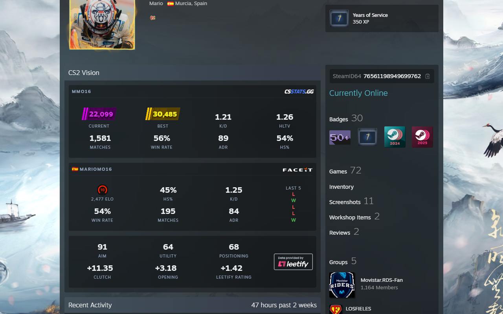

# CS2 Vision

View CSStats, FACEIT and Leetify data, plus Steam account information.

[](https://chromewebstore.google.com/detail/cs2-vision/clploogmlpocoolonhlogblopobiccgb)
[](https://chromewebstore.google.com/detail/cs2-vision/clploogmlpocoolonhlogblopobiccgb)
[](https://chromewebstore.google.com/detail/cs2-vision/clploogmlpocoolonhlogblopobiccgb)

<picture>
  
</picture>

## Features

- **SteamID64 Display:** Auto-detected and shown below the profile info
- **CS2 Premier Ratings:** Current and best season ratings with tier-based color and SVG badges
- **General Stats:** K/D Ratio, HLTV Rating, Matches played, Win Rate, HS%, and ADR (aggregated from Competitive, Premier, FACEIT, and ESEA 5v5 matches)
- **Tracking Status:** Detects disabled or inactive match tracking and shows a contextual message
- **Private Profile Handling:** Shows a message when the csstats.gg profile is private
- **FACEIT Integration:** Skill level, ELO, stats, player name, country flag, and profile link
  - **Verified Badge:** Shows a verified icon next to the FACEIT name for VIP verified accounts
  - **Challenger Badges:** Regional top 1000 players show the regional challenger badge with rank

## Install

### Setup

```bash
pnpm install
```

### Build

```bash
pnpm dev     # development build -> dist-dev/
pnpm build   # production build  -> dist/
```

Each build writes a self-contained extension (`manifest.json`, `content.js`, `background.js`, `content.css`, `assets/`) to its output directory. Load that directory as an unpacked extension in `chrome://extensions/` with developer mode enabled.

## License

MIT
