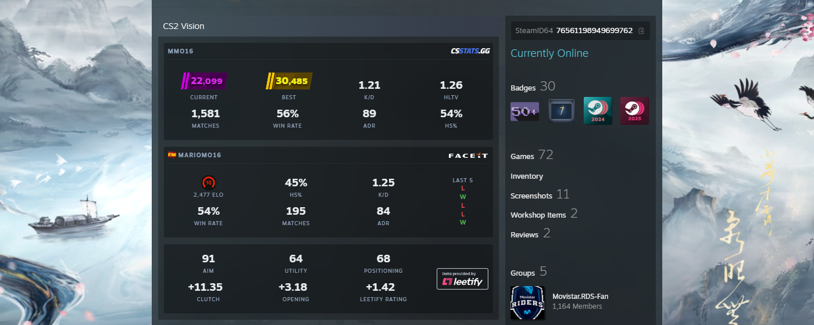

# CS2 Vision

View CSStats, FACEIT and Leetify data, plus Steam account information.

<picture>
  
</picture>

## Features

- **SteamID64 Display** — Auto-detected and shown below the profile info
- **CS2 Premier Ratings** — Current and best season ratings with tier-based color and SVG badges
- **General Stats** — K/D Ratio, HLTV Rating, Matches played, Win Rate, HS%, and ADR (aggregated from Competitive, Premier, FACEIT, and ESEA 5v5 matches)
- **Tracking Status** — Detects disabled or inactive match tracking and shows a contextual message
- **Private Profile Handling** — Shows a message when the csstats.gg profile is private
- **FACEIT Integration** — Skill level, ELO, stats, player name, country flag, and profile link
  - **Verified Badge** — Shows a verified icon next to the FACEIT name for VIP verified accounts
  - **Challenger Badges** — Regional top 1000 players show the regional challenger badge with rank

## Install

```bash
pnpm install
pnpm dev
```

Output goes to `dist/` (`content.js`, `background.js`). Load as an unpacked extension in `chrome://extensions/` (developer mode).

> `pnpm build` is reserved for GitHub Actions. Use `pnpm dev` for local development and testing.

## License

MIT
